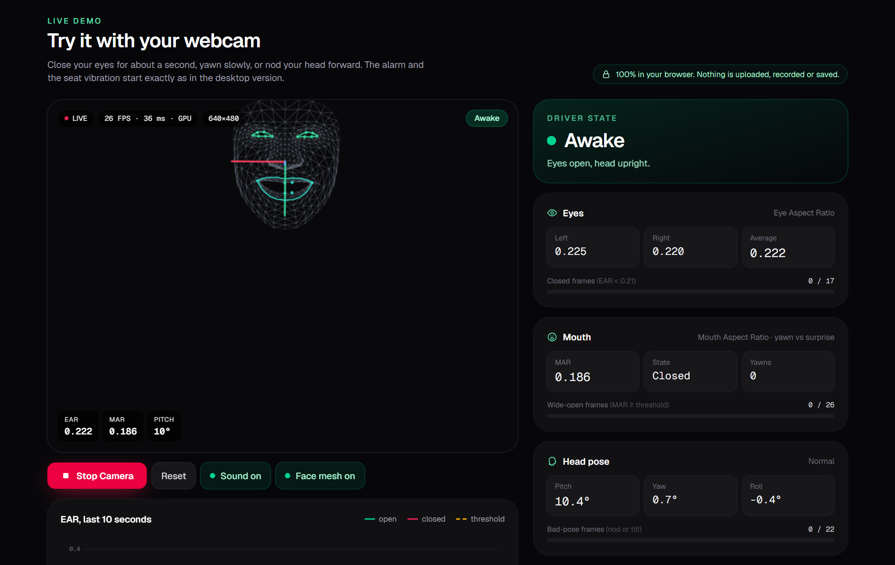
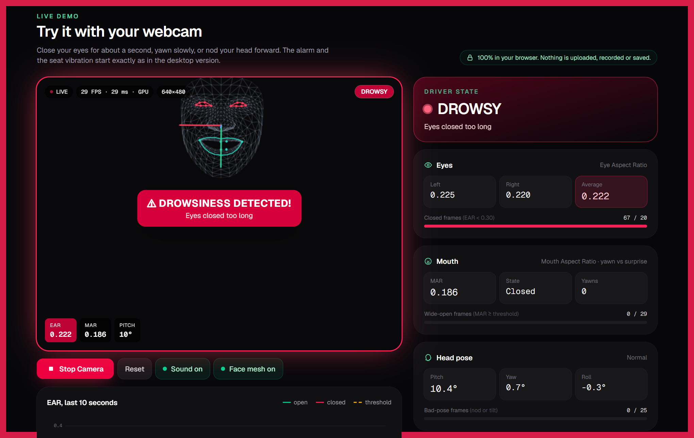
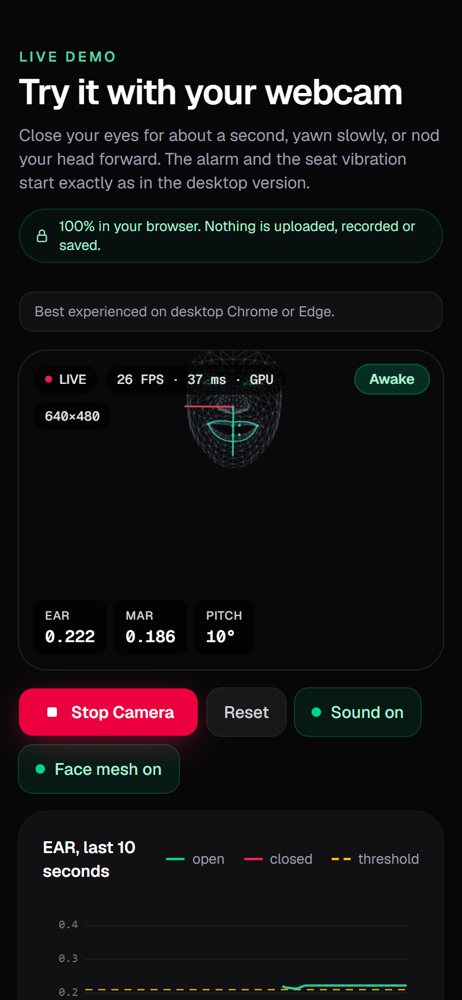
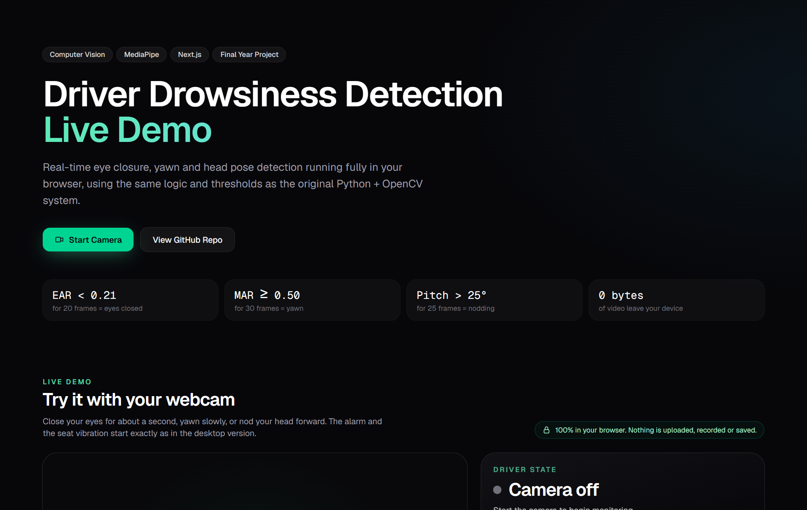
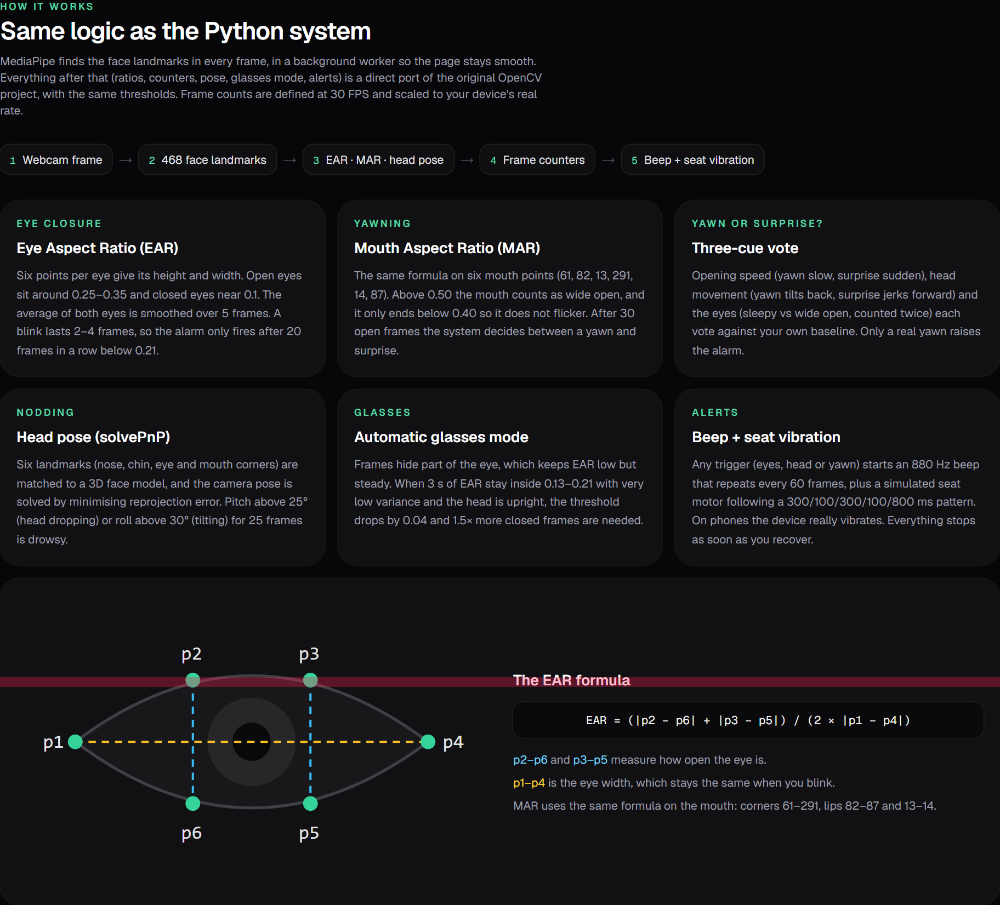

# Driver Drowsiness Detection — Live Web Demo

**[▶ Try it live](https://drowsiness-web-demo.vercel.app)** · [Original Python + OpenCV project](https://github.com/husnainzahid050-hub/cv-driver-drowness-detection)


A browser version of my Final Year Project (BS Artificial Intelligence). It watches your webcam in real time for **eye closure, yawning and head nodding**, and raises the same alarm as the desktop system. Everything runs on your own device; no video ever leaves it.

The detection logic is a direct TypeScript port of the Python project: same landmarks, formulas, thresholds and frame counters. Only the landmark model runs through MediaPipe Tasks for the web instead of MediaPipe for Python.



## Screenshots

| Drowsiness alarm | Phone |
| --- | --- |
|  |  |

| Landing page | How it works |
| --- | --- |
|  |  |

*The camera image is hidden in these screenshots; only the landmark wireframe and the dashboard are shown.*

## Features

- **Eye closure:** EAR per eye and averaged, 5-frame smoothing, alarm after 20 consecutive frames below 0.21
- **Yawn vs surprise:** 6-point MAR with hysteresis (0.50 in, 0.40 out) and 30-frame confirmation, then a vote on opening speed, head movement and eyes against the driver's own baseline
- **Head pose:** solvePnP on 6 landmarks against a 3D face model; nodding (pitch > 25°) or tilting (|roll| > 30°) for 25 frames
- **Glasses mode:** detects steady, suppressed EAR and relaxes the threshold (−0.04) and frame count (×1.5)
- **Alerts:** 880 Hz beep repeated every 60 frames, plus a simulated seat vibration (300/100/300/100/800 ms buzz pattern); phones vibrate for real
- **Live dashboard:** HUD on the video, EAR/MAR/pitch/yaw/roll, frame-counter bars, 10-second EAR graph, session stats, FPS and inference time
- **Controls:** Start / Stop Camera, Reset, sound and face-mesh toggles, sensitivity sliders (defaults = Python settings)
- **Fast and smooth:** detection runs in Web Workers. The CPU worker starts detecting about a second after Start, the GPU worker warms up in the background, and the faster one is kept (up to 30 FPS on an Intel UHD 620 laptop)
- **Same timing at any frame rate:** frame counts are defined at 30 FPS like the Python version and scaled to the real detection rate

## How it works

```
Webcam frame → 468 face landmarks → EAR · MAR · head pose → frame counters → beep + seat vibration
```

| Python module             | Web port            |
| ------------------------- | ------------------- |
| `config/settings.py`      | `lib/settings.ts`   |
| `src/ear_calculator.py`   | `lib/ear.ts`        |
| `src/yawn_detector.py`    | `lib/yawn.ts`       |
| `src/head_pose.py`        | `lib/headPose.ts`   |
| `src/glasses_detector.py` | `lib/glasses.ts`    |
| `src/alert_manager.py`    | `lib/alerts.ts`     |
| `src/detector.py`         | `lib/detector.ts`   |

**Eye Aspect Ratio**

```
EAR = (|p2 − p6| + |p3 − p5|) / (2 × |p1 − p4|)
left eye 362, 385, 387, 263, 373, 380 · right eye 33, 160, 158, 133, 153, 144
```

**Mouth Aspect Ratio**

```
MAR = (|p2 − p6| + |p3 − p5|) / (2 × |p1 − p4|)   on points 61, 82, 13, 291, 14, 87
```

**Head pose.** Nose (4), chin (152), eye corners (33, 263) and mouth corners (61, 291) are matched to a 3D face model. The rotation is found by minimising the reprojection error with Levenberg–Marquardt, then decomposed into pitch, yaw and roll. On 300 test poses it agrees with `cv2.solvePnP` to within 0.09° on average.

**Alarm.** It starts when any of these holds: eyes closed for the frame limit, a bad head pose for 25 frames, or a confirmed yawn. It stops as soon as none of them holds.

## Tech stack

- [Next.js](https://nextjs.org) (App Router) + TypeScript, Tailwind CSS
- [MediaPipe Face Landmarker](https://ai.google.dev/edge/mediapipe/solutions/vision/face_landmarker) (`@mediapipe/tasks-vision`) in Web Workers
- Canvas 2D for the overlay and graph, Web Audio API for the alarm (no audio files)

The MediaPipe runtime and model are served from this site, not a third-party CDN. There is no backend, API route, database, analytics or environment variable.

## Run locally

Requires Node.js 20 or newer.

```bash
npm install
npm run dev        # copies the MediaPipe runtime into public/ and starts http://localhost:3000
npm run build      # production build
```

Browsers only allow webcam access on `localhost` or over HTTPS.

## Deploy

Import the repository on [Vercel](https://vercel.com/new) and keep the defaults.

## Privacy

Everything runs in your browser. No video, images or measurements are uploaded, recorded or stored, not even in browser storage. Closing the tab or pressing **Stop Camera** turns the camera off.

## Author

**Husnain Abbasi** · [GitHub](https://github.com/husnainzahid050-hub)
